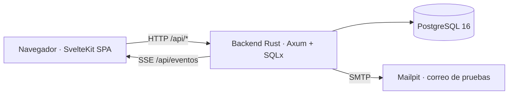
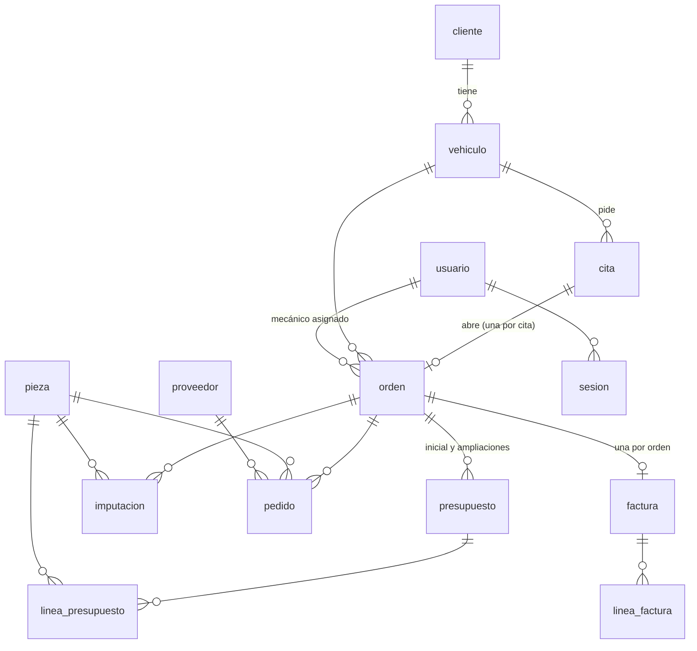
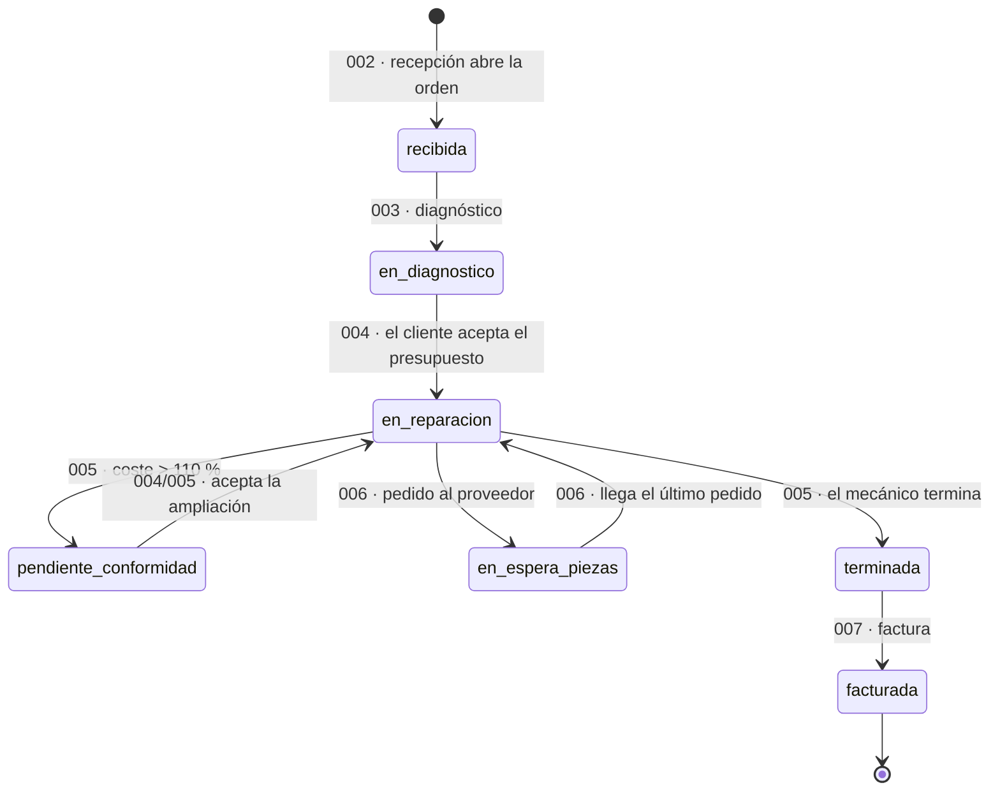

# Memoria del proyecto · Talleres Rueda

## 1. Portada y resumen

**Talleres Rueda · Gestión de un taller mecánico** (práctica SI-26)

| | |
|---|---|
| Autores | Persona A · @evm60-ua (HU-01, HU-02, HU-04 y HU-08) · Persona B · @senabre (HU-03, HU-05, HU-06 y HU-07) |
| Fecha | 12/11/2026 |
| Versión del código | rama `entrega`, commit `2a7dfce` |
| Repositorio | https://github.com/senabre/taller-mecanico |

**Resumen.** Talleres Rueda es una aplicación web que acompaña a cada vehículo desde que el cliente
pide cita hasta que se lo lleva reparado y facturado. La usan el cliente, que pide cita y responde al
presupuesto desde un enlace sin entrar en la aplicación, y el personal del taller: recepción, mecánicos,
almacén y el jefe de taller, que ve todas las órdenes abiertas en un tablero que se actualiza solo. Se
ha construido con desarrollo guiado por especificaciones (Spec Kit): una base común y **8
especificaciones**, una por historia de usuario, repartidas entre dos personas. El resultado:
- **326 tareas**, de las que solo quedan 2: las revisiones finales de la Persona B (T031 de 004 y T032 de 008).
- **177 pruebas automáticas en verde**: 156 de backend (155 con `cargo test` y una más que se lanza
  aparte porque tarda unos 100 s) y 21 de frontend (Vitest).
- La guía de validación (quickstart común) se recorrió en un navegador real automatizado. La regresión
  final, §0–§8, no tuvo ningún fallo de la aplicación, y el recorrido completo de la cita a la factura
  (§9) dio 10 de 10.
- De los **126 criterios** de aceptación y de éxito de las 8 historias, **118 están verificados** y
  **8 verificados con desviación** (ninguno pendiente), según la
  [matriz de trazabilidad](../specs/matriz-trazabilidad.md).

## 2. Repositorio

- **URL**: https://github.com/senabre/taller-mecanico
- **Rama principal**: `main`, a la que se fusionan las specs. La rama `entrega` contiene `main` más la
  documentación final (matriz, recorridos, agrupamiento, revisión cruzada y esta memoria), todavía sin
  fusionar.

## 3. Introducción

**Contexto.** Un taller mecánico gestiona hoy cada reparación con llamadas, papeles y una pizarra.
El cliente tiene que llamar o ir al taller para pedir cita y para aprobar el presupuesto. Recepción
anota a mano el estado del coche al recibirlo. Los mecánicos apuntan tiempos y piezas que después
hay que volver a teclear en la factura. Y el jefe de taller sigue las órdenes en una pizarra (las HU
de cada spec, enlazadas en el apartado 4).

**Problema.** Sin un sistema común se pierden datos y tiempo:
- discusiones sobre el estado en que se entregó el coche;
- presupuestos que no constan como aceptados;
- trabajo que no llega a la factura;
- órdenes paradas esperando una pieza sin que nadie lo vea;
- retrasos que solo se detectan cuando el cliente reclama.

**Objetivos**, uno por historia de usuario:
1. Que el cliente pida cita en línea, sin llamar (HU-01).
2. Que recepción abra la orden con el kilometraje y los daños visibles (HU-02).
3. Que el mecánico registre el diagnóstico y un presupuesto línea a línea (HU-03).
4. Que el cliente acepte o rechace el presupuesto desde un enlace (HU-04).
5. Que el mecánico impute el tiempo y las piezas reales, con un tope sobre lo presupuestado (HU-05).
6. Que el almacén pida al proveedor las piezas que faltan, con la orden parada mientras tanto (HU-06).
7. Que la factura salga de lo imputado y el cliente reciba el aviso (HU-07).
8. Que el jefe vea todas las órdenes abiertas por estado, con los retrasos y la carga de cada
   mecánico, en un tablero que se actualiza solo (HU-08).

Todo bajo la [constitución](../.specify/memory/constitution.md) (v1.2.1): simplicidad, español de
España y euro, cero alcance fantasma, verificable por una persona no técnica y respeto por los datos.

## 4. Análisis

### Actores y roles

| Actor | Rol en la app | Qué hace |
|---|---|---|
| Cliente | Sin sesión | Pide cita (`/cita`) y responde al presupuesto desde el enlace del correo (`/presupuesto/[token]`) |
| Recepcionista | `recepcion` | Ve las citas, abre las órdenes, factura y consulta el historial |
| Mecánico | `mecanico` | Ve sus órdenes, diagnostica, presupuesta, imputa y termina la reparación |
| Responsable de almacén | `almacen` | Da de alta piezas, pide al proveedor y recibe los pedidos |
| Jefe de taller | `jefe` | Puede hacer todo lo anterior y es el único que ve el tablero |

Cada empleado entra con su usuario y su contraseña (base común, research R8).

### Historias de usuario

El reparto entre las dos personas y su porqué están en [agrupamiento.md](agrupamiento.md).

| HU | Historia | Prioridad · pts | Persona | Spec | Historias / escenarios / FR / SC |
|---|---|---|---|---|---|
| HU-01 | Como cliente, pedir cita indicando la matrícula y el motivo, para no tener que llamar ni ir al taller | Alta · 3 | A | [spec-001](../specs/001-pedir-cita-en-linea/spec.md) | 3 / 16 / 11 / 4 |
| HU-02 | Como recepcionista, abrir la orden al recibir el coche, anotando el kilometraje y los daños visibles | Alta · 3 | A | [spec-002](../specs/002-abrir-orden-reparacion/spec.md) | 2 / 12 / 8 / 4 |
| HU-03 | Como mecánico, registrar el diagnóstico y un presupuesto línea a línea con mano de obra y piezas | Alta · 5 | B | [spec-003](../specs/003-diagnostico-presupuesto/spec.md) | 3 / 10 / 10 / 4 |
| HU-04 | Como cliente, aceptar o rechazar el presupuesto desde un enlace | Alta · 5 | A | [spec-004](../specs/004-aceptar-presupuesto-enlace/spec.md) | 4 / 11 / 9 / 4 |
| HU-05 | Como mecánico, cargar en la orden el tiempo real y las piezas montadas | Alta · 5 | B | [spec-005](../specs/005-imputar-tiempo-piezas/spec.md) | 4 / 9 / 8 / 4 |
| HU-06 | Como responsable de almacén, pedir al proveedor una pieza que falta, vinculada a su orden | Media · 3 | B | [spec-006](../specs/006-pedido-pieza-proveedor/spec.md) | 4 / 13 / 13 / 6 |
| HU-07 | Como recepcionista, generar la factura a partir de lo imputado y avisar al cliente | Alta · 3 | B | [spec-007](../specs/007-facturar-avisar-cliente/spec.md) | 3 / 8 / 9 / 4 |
| HU-08 | Como jefe de taller, ver en un tablero las órdenes abiertas agrupadas por estado | Media · 5 | A | [spec-008](../specs/008-tablero-ordenes-abiertas/spec.md) | 4 / 13 / 6 / 4 |
| **Total** | | **32 pts** (16 por persona) | | | **27 / 92 / 74 / 34** |

### Requisitos funcionales (resumen por HU)

- **HU-01**:
  - matrícula de 2 a 10 letras o cifras, sin importar espacios ni guiones;
  - un vehículo conocido muestra marca y modelo sin datos del cliente, y uno nuevo pide sus datos;
  - días laborables desde mañana hasta dentro de 30 días, con un cupo diario;
  - como mucho una cita pendiente por matrícula;
  - recepción y el jefe ven la lista del día.
- **HU-02**:
  - la orden solo se abre el día de la cita, una por cita;
  - número correlativo sin huecos;
  - el kilometraje no puede ser menor que el de la visita anterior;
  - mecánico activo y daños obligatorios;
  - la ficha muestra la cita, el vehículo y el mecánico.
- **HU-03**:
  - el diagnóstico pasa la orden a «en diagnóstico»;
  - líneas de mano de obra (en múltiplos de 0,25 h) y de pieza (enteras, solo del almacén);
  - totales con IVA;
  - al emitir, el presupuesto caduca a los 15 días y se envía el enlace al cliente.
- **HU-04**:
  - página pública por enlace, sin datos del cliente;
  - una sola respuesta, con confirmación;
  - aceptar pasa la orden a «en reparación» y rechazar la deja como estaba;
  - un presupuesto caducado no admite respuesta;
  - sin presupuesto aceptado no se imputa;
  - el personal ve el enlace mientras está vigente.
- **HU-05**:
  - imputar horas y piezas descuenta el stock;
  - si el coste pasa del 110 % de lo presupuestado, la orden queda pendiente de conformidad hasta una ampliación aceptada;
  - solo se termina con imputaciones.
- **HU-06**:
  - alta de piezas con referencia única;
  - un pedido deja la orden «en espera de piezas»;
  - al recibir el último pedido, la orden vuelve sola a reparación y el stock sube.
- **HU-07**:
  - factura con número único a partir de lo imputado;
  - impresión limpia y logo opcional;
  - correo «listo para recoger»;
  - historial por matrícula.
- **HU-08**:
  - seis columnas, una por estado abierto;
  - carga por mecánico que cuadra con las tarjetas;
  - las retrasadas destacadas;
  - solo el jefe lo ve;
  - se actualiza solo con cada cambio, al reconectar y a medianoche.

### Requisitos no funcionales

De la constitución y del plan maestro:
- Español de España, importes en euros (`1.234,56 €`) y fechas dd/mm/aaaa, con «hoy» en Europe/Madrid (R12).
- Ningún secreto en el repositorio (R7, principio V).
- Usable en el móvil (390 px) en las páginas públicas y en el tablero.
- Rendimiento medido en los criterios de éxito de cada spec. Por ejemplo, una cita en menos de 1 minuto
  (HU-01 SC-001) o un cambio en el tablero en menos de 5 s (HU-08 SC-002).
- Cada criterio comprobable por una persona en la aplicación (principio IV).

## 5. Diseño

### Arquitectura

Un solo proceso y un solo origen (R2). El backend en **Rust con Axum** sirve la API JSON en
`/api/*` y también la SPA compilada de **SvelteKit**, así que no hay CORS ni dos servidores.



- **Base de datos**: PostgreSQL 16, con migraciones SQLx.
- **Correo**: `lettre` por SMTP, a **Mailpit** en desarrollo (R10).
- **Tiempo real**: el tablero escucha **Server-Sent Events** en `GET /api/eventos`. Cada cambio de
  estado de una orden se publica después del `commit` (R11, R14).
- **Sesión**: en el servidor, con una cookie y contraseñas con argon2 (R8).

### Modelo de datos

El modelo es único, en el [data-model común](../specs/000-base-comun/data-model.md). Tablas
principales:



Además están `contador` (números correlativos de orden y de factura, R5) y `usuario` (personal con su
rol).

**Máquina de estados de la orden.** Todas las transiciones pasan por una sola función,
`estados::cambiar_estado` (R14). Cada una la provoca la spec que se indica:



### Decisiones técnicas y por qué

De la [constitución](../.specify/memory/constitution.md), el
[plan maestro](../specs/000-base-comun/plan.md), el
[research común](../specs/000-base-comun/research.md) y los `research.md` de cada spec:

| Decisión | Por qué |
|---|---|
| Un solo proceso que sirve la API y la SPA (R2) | Lo más simple: un despliegue, sin CORS (principio I) |
| Dinero en `NUMERIC(12,2)` y `rust_decimal`; el IVA se redondea una vez sobre la base (R4) | Sin errores de coma flotante; los totales cuadran con la calculadora |
| Números de orden y de factura con una tabla `contador` dentro de la misma transacción (R5) | Correlativos sin huecos, incluso con intentos rechazados (spec-002 Q6) |
| Cupo diario con `pg_advisory_xact_lock` por fecha (R6) | Nunca más citas que el cupo, aunque dos clientes confirmen a la vez |
| Enlace del presupuesto con un token aleatorio de 32 bytes (R9), y la respuesta guardada con un solo `UPDATE` condicional (spec-004 Q4, D2) | El cliente no necesita cuenta, y de dos respuestas a la vez solo cuenta una |
| SSE en vez de WebSockets para el tablero (R11) | Basta la comunicación del servidor al navegador; se reconecta solo |
| «Hoy» siempre en Europe/Madrid (R12) | Caducidades, retrasos y días de cita dependen del día en España |
| Una sola función para los cambios de estado, que publica el evento después del `commit` (R14) | Ninguna transición se salta el tablero, y este nunca ve un estado sin guardar |
| Cada spec en su módulo de rutas, su fichero de pruebas y su sección de la ficha | Cada persona trabaja en sus ficheros; los compartidos se revisan entre las dos |

## 6. Implementación

### Pila tecnológica

Versiones de `Cargo.lock` y `package-lock.json` en `2a7dfce`:

| Capa | Tecnología | Versión |
|---|---|---|
| Backend | Rust (edición 2024) · Axum · Tokio · SQLx · tower-http | Axum 0.8.9 · Tokio 1.53.3 · SQLx 0.8.6 · tower-http 0.6.11 |
| Dinero, fechas y seguridad | rust_decimal · chrono · chrono-tz · argon2 | 1.43.0 · 0.4.45 · 0.10.4 · 0.5.3 |
| Correo | lettre | 0.11.23 |
| Frontend | SvelteKit (Svelte 5) con adapter-static · TypeScript · Vite | Kit 2.70.3 · Svelte 5.57.2 · TS 5.9.3 · Vite 8.3.4 |
| Estilos | Tailwind CSS · Skeleton | 4.3.3 · Skeleton 3.2.2 (skeleton-svelte 1.5.3) |
| Pruebas | `#[sqlx::test]` (backend) · Vitest (frontend) | Vitest 5.0.5 |
| Servicios | PostgreSQL · Mailpit (Docker Compose) | `postgres:16` · `axllent/mailpit:v1.27` |

Requisitos según el quickstart: Docker, Rust estable y Node 22. En el equipo de desarrollo de la
Persona A se usaron rustc 1.99.0, Node 25.8.0 y Docker 28.5.1.

### Estructura del repositorio

```text
.specify/memory/constitution.md   constitución
specs/000-base-comun/             plan maestro, research común, data-model, contrato y quickstart comunes
specs/00N-…/                      una spec por HU: spec, plan, research, tasks, evidencias…
specs/matriz-trazabilidad.md · specs/revision-cruzada.md · specs/recorridos/
backend/migrations/               0001 esquema · 0002 líneas (003) · 0003 imputaciones (005)
backend/seed/demo.sql             datos demo
backend/src/                      auth, config, contador, correo, dinero, error, estados, eventos,
                                  fechas, formato, lineas, matricula y rutas/ (un módulo por spec)
backend/tests/                    un fichero de pruebas por spec, más tests/comun
frontend/src/routes/              cita, citas, ordenes (con la ficha por secciones), presupuesto,
                                  almacen, pedidos, facturas, historial, tablero, entrar
frontend/src/lib/                 api, formato, tipos, componentes/, medianoche, recarga, eventos
docs/                             agrupamiento.md y esta memoria
```

### Partes más relevantes del código

- **`backend/src/estados.rs`**: la máquina de estados y `cambiar_estado`. Devuelve un `CambioEstado`
  marcado `#[must_use]`, para que quien la llama no olvide publicarlo después del `commit`.
- **`backend/src/rutas/publico_presupuesto.rs`** (004): la respuesta del cliente con un solo `UPDATE`
  que comprueba a la vez que el presupuesto sigue emitido y vigente. El cambio de estado de la orden va
  en la misma transacción.
- **`backend/src/rutas/tablero.rs`** (008): una sola lista de órdenes abiertas para las columnas, y la
  carga por mecánico contada en Rust sobre esa misma lista, sin transacción (V3).
- **`backend/src/lineas.rs`** (005): una sola validación de líneas para el presupuesto y las imputaciones.
- **`frontend/src/lib/eventos.ts`, `recarga.ts` y `medianoche.ts`** (008): la conexión de eventos con
  reconexión, una sola petición del tablero a la vez, y la medianoche de Madrid calculada con `Intl`.

### Decisiones tomadas sobre la marcha

| Decisión | Dónde | Por qué |
|---|---|---|
| **Sin transacción en `GET /api/tablero`** | spec-008, hallazgo V3 · [research D1](../specs/008-tablero-ordenes-abiertas/research.md) · [hallazgos](../specs/008-tablero-ordenes-abiertas/hallazgos.md) | La regresión T030 se paró: si el navegador cortaba la petición mientras esperaba la respuesta del `BEGIN`, SQLx 0.8.6 devolvía la conexión al *pool* dentro de la transacción de solo lectura y fallaban peticiones de toda la app. Se quitó la transacción y la carga pasó a contarse en Rust. Una prueba que corta unas 4600 peticiones falló 3 de 3 antes y pasa después |
| **Un solo `UPDATE` para «solo cuenta la primera respuesta»** | spec-004, clarify Q4 · [research D2](../specs/004-aceptar-presupuesto-enlace/research.md) · D1 de la base común | Había dos versiones de la sentencia; se dejó una, que comprueba y guarda a la vez. Se probó con dos respuestas simultáneas y con mutación |
| **Sin la autotransición en_diagnostico → en_diagnostico** | spec-004, clarify Q2 · [hallazgos de la base común](../specs/000-base-comun/hallazgos.md) (I5) | Rechazar el presupuesto no cambia el estado de la orden, así que no hay transición que registrar |
| **Con cupo 0 no se ofrece ningún día** | spec-001, hallazgo H1 · T041 | La verificación en el navegador encontró días ofrecidos que el servidor rechazaba |
| **La orden solo se abre el día de la cita** | spec-002, clarify Q2 | Evita órdenes sin coche presente; obligó a crear citas de «hoy» en los datos demo |
| **La entrega de la orden demo 3, hoy** | spec-008, research D8 · T001 | Para ver en la app una orden con la entrega de hoy, que no sale retrasada |
| **`confirm()` del navegador en emitir, terminar y facturar** | specs 003, 005 y 007 · V2 de spec-008 · [revisión cruzada](../specs/revision-cruzada.md) (O1) | Los botones salen en el idioma del navegador (principio II). Queda como trabajo futuro de la Persona B |

## 7. Pruebas y validación

### Estrategia

- **Pruebas de backend** con `#[sqlx::test]`: una base limpia por prueba, una prueba por regla de
  negocio, y los datos creados en cada prueba, sin valores demo (R13, principio V).
- **Pruebas de frontend** con Vitest para la lógica sin pantalla: el formato, la medianoche con reloj
  simulado, una sola petición a la vez y la reconexión con un `EventSource` simulado.
- **Rojo antes del verde**: cada prueba se escribió antes que el código y se vio fallar.
- **Mutaciones**: cuando una regla ya existía, se rompió a propósito, se comprobó que la prueba fallaba
  y se restauró con `cmp`. Por ejemplo, la condición de la carga y `<` por `<=` en «retrasada» (008), o
  `estado = 'emitido'` en el `UPDATE` (004).
- **Navegador automático** (Playwright, Chromium en español y con la zona horaria de Madrid), que sigue
  los pasos de una persona en el quickstart común, a 1280–1920 px y a 390 px.
- **Cronometrajes humanos** de los criterios de tiempo, con una persona y un reloj.

### Resultados de las pruebas automáticas

Ejecutadas el 12/11/2026 sobre `2a7dfce`, con `cd backend && cargo test --no-fail-fast`, aparte
`cargo test --test spec008_tablero -- --ignored`, y `cd frontend && npm test`:

| Fichero | Spec | Persona | Pruebas | Resultado |
|---|---|---|---|---|
| Unitarias de `backend/src` (`dinero`, `fechas`, `formato`, `matricula` y `rutas/citas`) | Base común y specs | Las dos | 16 | 16 pasan |
| `spec000_contador.rs` | 000 | Base común | 3 | 3 pasan |
| `spec000_estados.rs` | 000 | Base común | 7 | 7 pasan |
| `spec000_sesion.rs` | 000 | Base común | 12 | 12 pasan |
| `spec001_citas.rs` | 001 | A | 15 | 15 pasan |
| `spec002_ordenes.rs` | 002 | A | 12 | 12 pasan |
| `spec003_presupuestos.rs` | 003 | B | 20 | 20 pasan |
| `spec004_respuesta.rs` | 004 | A | 16 | 16 pasan |
| `spec005_imputaciones.rs` | 005 | B | 12 | 12 pasan |
| `spec006_pedidos.rs` | 006 | B | 23 | 23 pasan |
| `spec007_facturas.rs` | 007 | B | 11 | 11 pasan |
| `spec008_tablero.rs` | 008 | A | 9 | 8 pasan; la 9 lleva `#[ignore]` y pasa al lanzarla aparte (unos 158 s) |
| **Backend** | | | **156** | **156 pasan** (155 con `cargo test` y 1 aparte) |
| Vitest: `formato.test.ts`, `medianoche.test.ts`, `recarga.test.ts` y `eventos.test.ts` | Base común y 008 | Las dos | 21 | 21 pasan |
| **Total** | | | **177** | **177 pasan, 0 fallan** |

Además, `cargo clippy --all-targets -- -D warnings` sin avisos, y `npm run check` y `npm run build`
correctos ([comprobaciones de converge-1 de 008](../specs/008-tablero-ordenes-abiertas/evidencias/T033-T038-comprobaciones.txt)).

### Validación en el navegador (Persona A)

| Spec | Verificación | Resultado | Evidencia |
|---|---|---|---|
| 001 | Quickstart §1 (T032), con la repetición tras T041 | 31/31 | [T032](../specs/001-pedir-cita-en-linea/evidencias/T032/verificacion.md) |
| 002 | Quickstart §2 (T029) | 23/23 (US1) y 3/3 (US2 y móvil) | [T029](../specs/002-abrir-orden-reparacion/evidencias/T029/verificacion.md) |
| 004 | Quickstart §4 (T027) | 20/20 | [T027](../specs/004-aceptar-presupuesto-enlace/evidencias/T027/verificacion.md) |
| 008 | Quickstart §8 (T028), su complemento y las comprobaciones de la matriz | 13/14 (la que falla es la parte opcional del §8.9, que se quitó por V1), 6/6 y 2/2 | [T028](../specs/008-tablero-ordenes-abiertas/evidencias/T028/verificacion.md), [complemento](../specs/008-tablero-ordenes-abiertas/evidencias/T028/complemento.md), [matriz](../specs/008-tablero-ordenes-abiertas/evidencias/matriz/informe.md) |

**Cronometrajes humanos**:
- HU-01: SC-001 en 47 s y SC-002 en 1 min 27 s.
- HU-02: SC-001 en 31 s.
- HU-04: SC-001 en 13 s, con la orden Nº 4.
- HU-08: SC-001 en 5 s y SC-002 en 4 s.

**Validación de la Persona B**:
- Las verificaciones en pantalla de 003, 005, 006 y 007 constan como notas en sus `tasks.md` (T035, T034,
  T032 y T028).
- Los criterios de tiempo se midieron con el navegador automático
  ([matriz B](../specs/recorridos/matriz-B/informe.md), 7/7).
- *Pendiente de que lo complete la Persona B*: si hay un informe de verificación en el navegador de sus
  quickstart con su resultado.

### Recorridos integrados (apartado 5.4)

Detalle en [recorridos-integrados.md](../specs/recorridos/recorridos-integrados.md). Los dos conectan
historias de las dos personas y están revisados por las dos.

| Recorrido | Tipo | Historias | Resultado |
|---|---|---|---|
| R1 · `3579KLM` de la cita a la factura (§9) | Satisfactorio | 001, 002, 004, 008 · 003, 005, 007 | 10/10 |
| R2 · Presupuesto rechazado: la orden queda bloqueada | Error, permiso y estado | 002, 004, 008 · 003, 005, 007 | 9/9 |

### Regresión

| Regresión | Sobre | Resultado | Evidencia |
|---|---|---|---|
| T029 de spec-004 | Quickstart §0–§7 con los datos demo de 004 (`8d64285`) | 111 comprobaciones: 109 a la primera y las 2 de §7.3 y §7.4 al repetirlas (eran fallos del script). §8 y §9 quedaron pendientes de spec-008 | [T029 de 004](../specs/004-aceptar-presupuesto-enlace/evidencias/T029/verificacion.md) |
| T030 de spec-008 | Quickstart §0–§8 con todo el código (`02e9868`), después de arreglar V3 | 123/124, sin ningún fallo de la aplicación (la que falla es la parte opcional del §8.9, que se quitó del quickstart). `estres.sh`: 0 errores | [T030 de 008](../specs/008-tablero-ordenes-abiertas/evidencias/T030/regresion/verificacion.md) |

El primer intento de T030 se paró en el §1 por V3
([hallazgo](../specs/008-tablero-ordenes-abiertas/evidencias/T030/hallazgo-conexiones.md)).

### Balance de la iteración

**Ambigüedades resueltas en los clarify** (preguntas con respuesta integrada en la spec):

| Spec | Preguntas | Registro |
|---|---|---|
| 000 · base común | 3 (R1: rechazo del presupuesto, datos de la factura, acceso del personal) | [research](../specs/000-base-comun/research.md) |
| 001 | 5, y 1 aclaración posterior en la spec (el aviso de FR-010) | [decisiones](../specs/001-pedir-cita-en-linea/decisiones-clarify.md) |
| 002 | 6 | [decisiones](../specs/002-abrir-orden-reparacion/decisiones-clarify.md) |
| 004 | 5 | [decisiones](../specs/004-aceptar-presupuesto-enlace/decisiones-clarify.md) |
| 008 | 4 | [decisiones](../specs/008-tablero-ordenes-abiertas/decisiones-clarify.md) |
| 003, 005, 006 y 007 | 4, 3, 5 y 3 (sección «Clarifications» de cada spec) | *Las specs de la Persona B no tienen `decisiones-clarify.md`; pendiente de que la Persona B indique si lo hay en otro sitio* |
| **Total** | **38** (más la aclaración de 001) | |

**Hallazgos de los analyze y converge**, en los `hallazgos.md`:

| Registro | Hallazgos | Cerrados | Asignados a otra spec o persona | Abiertos |
|---|---|---|---|---|
| [Base común](../specs/000-base-comun/hallazgos.md) | 33 | 31 | 2 (I9 → 007, D2 → 006) | 0 |
| [spec-001](../specs/001-pedir-cita-en-linea/hallazgos.md) | 21 | 20 | 1 (I4 → 007) | 0 |
| [spec-002](../specs/002-abrir-orden-reparacion/hallazgos.md) | 17 | 15 | 2 (I5(b) → 003; N3 → T031 de 004) | 0 |
| [spec-004](../specs/004-aceptar-presupuesto-enlace/hallazgos.md) | 25 | 22 | 2 (G1 e I8 → Persona B) | 1 (V2, pendiente de la Persona B) |
| [spec-008](../specs/008-tablero-ordenes-abiertas/hallazgos.md) | 17 | 16 | 1 (V2 → Persona B) | 0 |
| **Total** | **113** | **104** | **8** | **1** |
| Specs 003, 005, 006 y 007 | *No tienen `hallazgos.md` ni informes de analyze o converge; pendiente de que la Persona B lo indique* | | | |

I7 (el ejemplo «Ana» de la US2 de 008) se cerró el 12/11/2026: se corrigió en el clarify de spec-008
(«Luis 3 · Marta 1», commit `200b4db`). G6 (`EstadoOrden.svelte`) se cerró el 12/11/2026: se usa
`NOMBRE_ESTADO` de `formato.ts` y el plan maestro ya no menciona el componente; ese cambio del plan
maestro lo revisa la Persona B.

**Brechas de implementación pendientes**: 2 tareas de 326 (T031 de 004 y T032 de 008, las revisiones
finales de la Persona B, que se ha comprometido a marcarlas). El último converge de cada spec de la
Persona A no dejó tareas de código sin hacer (spec-008:
[converge-2](../specs/008-tablero-ordenes-abiertas/converge-2.md); T039 y T040 hechas).

**Criterios verificados**, de la [matriz](../specs/matriz-trazabilidad.md):

| | Criterios | Verificados | Con desviación | Pendientes |
|---|---|---|---|---|
| Persona A (HU-01, 02, 04 y 08) | 68 | 66 | 2 | 0 |
| Persona B (HU-03, 05, 06 y 07) | 58 | 52 | 6 | 0 |
| **Grupo** | **126** | **118 (93,7 %)** | **8 (6,3 %)** | **0** |

Las desviaciones son, sobre todo, criterios de tiempo medidos con el navegador automático en lugar de
con una persona. La Persona B ha aceptado pasar HU-05 US3-1 a verificado con la evidencia de la
regresión T030 ([revisión cruzada](../specs/revision-cruzada.md), O3); cuando lo haga, serán 119 y 7.

### Registro mínimo

Las filas más relevantes, al menos una por historia. El resto está en la
[matriz](../specs/matriz-trazabilidad.md) y en los `hallazgos.md` de cada spec.

| Historia y criterio | Hallazgo o decisión | Comando | Documentos o código afectados | Tarea y commit | Prueba y resultado | Responsable | Revisor | Estado |
|---|---|---|---|---|---|---|---|---|
| HU-01 · US1-5 (matrícula válida) | Clarify Q1: de 2 a 10 letras o cifras (cierra I11 de la base común) | `/speckit-clarify` | spec y research D1 de 001; `backend/src/matricula.rs` (compartido) | T001, T010 · `22f08be`, `224daaf` | `prueba_3_matricula_invalida` y unitarias de `matricula.rs`: pasan; T032 filas 1–4 | Persona A | Persona B (pendiente) | Verificado |
| HU-01 · US3-1 (día completo) | H1: con cupo 0 se ofrecían días que el servidor rechazaba | `/speckit-implement` (verificación T032) | `backend/src/rutas/citas.rs`, `cita/+page.svelte` | T041 · `00e6436` | `con_cupo_0_no_se_ofrece_ningun_dia`: pasa; T032 repetido 31/31 | Persona A | Persona B (pendiente) | Verificado |
| HU-02 · US1-9 y SC-002 (números consecutivos) | Clarify Q6: los rechazos no gastan número (C1 de analyze-1) | `/speckit-analyze`, `/speckit-clarify` | spec y research D2 de 002; `ordenes.rs` | T008 · `2516faf`, `d5106aa` | `prueba_2_correlativo_sin_huecos`, `prueba_3_concurrencia_del_numero`: pasan; T029 fila 12 | Persona A | Persona B (pendiente) | Verificado |
| HU-03 · US2-5 (quitar una línea recalcula) | Clarify Q2 de 003 | *No consta; lo completa la Persona B* | `presupuestos.rs`, `Presupuesto.svelte` | `dd77530` | `quitar_una_linea_recalcula_los_totales`: pasa | Persona B | Persona A, revisado el 12/11/2026 | Verificado |
| HU-04 · US1-4 (solo cuenta la primera respuesta) | Clarify Q4 y D1 de la base común: un solo `UPDATE` (R9) | `/speckit-clarify` | research R9; `publico_presupuesto.rs` | T010, T013 · `76dcdda`, `49c3188`, `7e66bad` | `dos_respuestas_a_la_vez_solo_cuenta_una` con mutación: pasa; T027 filas 15–16 | Persona A | Persona B (pendiente) | Verificado |
| HU-05 · US2-1 (el 110 % justo no bloquea) | Research D4 de 005 | *No consta; lo completa la Persona B* | `imputaciones.rs` | `09c887f` | `el_limite_del_10_por_ciento_es_exacto_al_centimo`: pasa | Persona B | Persona A, revisado el 12/11/2026 | Verificado |
| HU-06 · US3-2 (la orden espera al último pedido) | Research D4 de 006 | *No consta; lo completa la Persona B* | `almacen.rs` | `52448f3` | `con_dos_pedidos_la_orden_espera_al_ultimo`: pasa | Persona B | Persona A, revisado el 12/11/2026 | Verificado |
| HU-07 · US1-1 (factura de 157,30 €) | Research D1 y D6 de 007 | *No consta; lo completa la Persona B* | `facturas.rs`, `Factura.svelte` | `e2a2060` | `facturar_copia_las_imputaciones_y_cierra_la_orden`: pasa | Persona B | Persona A, revisado el 12/11/2026 | Verificado |
| HU-08 · SC-003 (la carga cuadra con las tarjetas) | V3: transacción cancelada a mitad | `/speckit-converge` (converge-1) | research D1 y D2 de 008; `tablero.rs`; R14 común | T033, T034 · `c4588e9` | `prueba9_peticiones_cortadas_no_dejan_conexiones_en_transaccion`: rojo 3/3 antes y verde después; `estres.sh`: 0 errores | Persona A | Persona B (pendiente, T032) | Verificado |
| HU-08 · US2-2 (mecánico de baja con órdenes) | Clarify Q1: los inactivos solo salen si tienen órdenes, marcados «(de baja)» | `/speckit-clarify` | spec, research D2 y contrato de 008 | T014, T015 · `200b4db`, `67f75d1` | `prueba6_inactivos_solo_con_ordenes_abiertas` con mutación: pasa; en la app, «Pedro (de baja) 1» | Persona A | Persona B (pendiente) | Verificado |

## 8. Despliegue y uso

### Instalación y ejecución

Según el apartado «Arrancar» del [quickstart común](../specs/000-base-comun/quickstart.md):

```bash
cp .env.example .env                       # ajustar los valores; ningún secreto en git
docker compose up -d                       # PostgreSQL y Mailpit
cd backend && cargo sqlx migrate run       # crea las tablas
psql "$DATABASE_URL" -f seed/demo.sql      # datos demo (o con el psql del contenedor, ver el quickstart)
cd ../frontend && npm ci && npm run build  # compila la SPA
cd ../backend && cargo run                 # la app, en http://localhost:3000
```

- **Variables de `.env.example`**: `POSTGRES_USER`, `POSTGRES_PASSWORD`, `POSTGRES_DB`,
  `DATABASE_URL`, `SMTP_URL`, `CORREO_REMITENTE`, `URL_PUBLICA`, `TALLER_CUPO_DIARIO`,
  `TALLER_PRECIO_HORA`, `TALLER_IVA_PORCENTAJE`, `TALLER_NOMBRE`, `TALLER_NIF`, `TALLER_DIRECCION`
  y `RUST_LOG`. Solo trae valores de ejemplo, y el `.env` real no se versiona (principio V). El logo de
  la factura es opcional, con `TALLER_LOGO` (spec-007).
- **Correos**: se ven en Mailpit, en http://localhost:8025.
- **Pruebas**: `cd backend && cargo test` (y, aparte, `cargo test --test spec008_tablero --
  --ignored`); `cd frontend && npm test`.
- **Datos demo**: se cargan el mismo día en que se usan, porque traen citas de «hoy».

### Usuarios demo

Los publica el quickstart común, con una contraseña ficticia solo para la demostración:

| Usuario | Rol |
|---|---|
| `ana` | recepción |
| `luis`, `marta` | mecánicos |
| `pepe` | almacén |
| `paco` | jefe de taller |
| `pedro` | mecánico de baja (no puede entrar ni recibir órdenes) |

### Manual breve por rol

- **Cliente**:
  - en `/cita`, escribe la matrícula, el motivo y elige un día;
  - si el vehículo es nuevo, da marca, modelo, nombre, teléfono y correo;
  - cuando el taller emite el presupuesto, recibe un correo con un enlace para aceptarlo o rechazarlo,
    con una confirmación antes de responder.
- **Recepción (`ana`)**:
  - en «Citas» ve las de hoy y abre la orden con el kilometraje, los daños, el mecánico y la fecha de
    entrega;
  - en «Órdenes» consulta la ficha;
  - con la orden terminada, pulsa «Facturar» y puede imprimir la factura;
  - en «Historial» busca por matrícula.
- **Mecánico (`luis`, `marta`)**: en «Mis órdenes», en la ficha de cada orden:
  - registra el diagnóstico;
  - prepara y emite el presupuesto;
  - imputa horas y piezas una vez aceptado;
  - termina la reparación.
- **Almacén (`pepe`)**:
  - en «Almacén» da de alta piezas y ve el stock;
  - en «Pedidos» pide al proveedor para una orden en reparación y marca los pedidos como recibidos.
- **Jefe (`paco`)**:
  - ve todo el menú;
  - en «Tablero» ve las órdenes abiertas por estado, la carga de cada mecánico y las retrasadas
    destacadas, y el tablero se actualiza solo.

## 9. Planificación y seguimiento

Del [plan maestro](../specs/000-base-comun/plan.md), de [agrupamiento.md](agrupamiento.md) y del
historial de git:

| Fase | Quién | Qué | Fechas |
|---|---|---|---|
| 0 · Base común | Las dos | Constitución, specs y plan (B, 15/10); tareas, análisis e implementación (A, 15–22/10) | 15/10 – 22/10/2026 |
| 1 · En paralelo | A: 001 → 002 → 004 → 008 · B: 006 → 003 → 005 → 007 | Una rama por spec | 22/10 – 12/11/2026 |
| 2 · Integración | Las dos | Quickstart §9 (R1), R2, matriz y revisión cruzada | 12/11/2026 |

**Ramas y entrada en `main`**:

| Fecha | Qué entra | Cómo |
|---|---|---|
| 22/10/2026 | Base común (A) | PR #1 (`spec-000`), fusionado por B |
| 22/10/2026 | spec-006 (B) | PR #2 (`spec-006`), fusionado por A |
| 22/10/2026 | spec-003 (B) | Commit directo |
| 29/10/2026 | spec-005 y spec-007 (B) | Commits directos |
| 05/11/2026 | spec-001 y spec-002 (A) | PR #3 (`spec-001`); `main` avanzó hasta la rama de spec-002, que llevaba spec-001 dentro |
| 05/11/2026 | Integración en la ficha de 003, 005, 006 y 007 (B) | Commits directos |
| 12/11/2026 | spec-004 y spec-008 (A) | PR #5 (`spec-008`, que lleva spec-004 dentro) y PR #4, fusionados por B |

**Commits**, por autor y por las rutas de sus specs (detalle en [agrupamiento.md](agrupamiento.md)):

| Persona | En sus specs | En las de la otra | Total en el repositorio |
|---|---|---|---|
| A (@evm60-ua) | 81 | 11 | 124 |
| B (@senabre, firma «Andres») | 13 | 2 | 16 |

Los recuentos no miden el trabajo de la misma forma: B subió cada spec en pocos commits grandes, y A,
en muchos commits pequeños por tarea.

**Fusiones con conflictos**: integrar `main` en las ramas de la Persona A obligó a resolver
conflictos en los ficheros donde cada spec registra lo suyo. Por ejemplo, el 29/10/2026, «Merge
origin/main (spec-005) en spec-001; conflicto en rutas/mod.rs resuelto conservando citas e
imputaciones».

## 10. Conclusiones

**Qué se consiguió.**
- Las 8 historias están implementadas, con todas sus tareas de código hechas (324 de 326; faltan dos
  revisiones).
- Hay 177 pruebas automáticas y todas pasan: 156 de backend, contando la que se lanza aparte, y 21 de
  frontend.
- El quickstart común se recorre entero sin fallos de la aplicación.
- De los 126 criterios, 118 están verificados y 8 verificados con desviación.
- El flujo completo de la cita a la factura funciona con las dos personas y con el tablero
  actualizándose solo.

**Problemas encontrados.**
- **V3, transacción cancelada a mitad (spec-008)**: el fallo más grave. Lo encontró la regresión y
  hacía fallar peticiones de toda la aplicación. Costó tres versiones de la prueba conseguir
  reproducirlo, porque la ventana es de una décima de milisegundo. Se arregló quitando la transacción.
- **Conflictos al fusionar** `main` en las ramas (`rutas/mod.rs`, `tipos.ts`), por las specs que se
  desarrollaban en paralelo.
- **Cambios de una persona en ficheros de la otra**: por ejemplo, `presupuestos.rs` (de B) cambiado
  por 004 (de A). Se resolvieron con aviso previo y revisión en commits propios.
- **Criterios de tiempo**: para medirlos hacía falta una persona con un reloj. Varios se midieron
  solo con el navegador automático y quedan como desviación.
- **El quickstart dependía del día**: los datos demo traen citas de «hoy», y el §9 necesita dos días.
  El día B se hizo adelantando el reloj.

**Trabajo futuro**, de los hallazgos abiertos de cada persona:
- **Persona B**:
  - sustituir los `confirm()` del navegador en «Emitir presupuesto», «Terminar reparación» y
    «Facturar» por una confirmación dentro de la página (V2, O1);
  - citar las capturas de la regresión T030 en sus filas de la matriz (O2) y pasar HU-05 US3-1 a
    verificado (O3);
  - marcar T031 de 004 y T032 de 008 (O5);
  - los hallazgos asignados a sus specs en los registros de la Persona A: G1 e I8 de 004, I5(b) de
    002, I4 de 001, e I9 y D2 de la base común. *Pendiente de que la Persona B confirme su estado.*
- **Persona A**:
  - la limitación aceptada de V1(b): una caída silenciosa de la red no se detecta hasta el siguiente
    evento o la medianoche.
- **Las dos**: completar la revisión cruzada de las filas de la matriz (64 de la Persona A y 54 de la
  Persona B, pendientes).

## 11. Demo

La demo está en [demo/](../demo/LEEME.md) y se entrega como `DemoSSD_GXX.zip`, con este contenido:

- **`index.html`**: la página de la demo. Se abre con doble clic, sin servidor. Muestra el vídeo y, al
  lado, las 8 historias con sus escenas y su minuto. Pulsar una escena salta a ella, y «Reproducir»
  en una historia reproduce solo esa historia y se para al terminar. También tiene escena
  anterior/siguiente, velocidad 0,75× y descarga del vídeo.
- **`demo.mp4`**: el vídeo, de 15:29 (H.264, 1280 × 800, 11,8 MB).
- **`capitulos.json`**: el momento en que empieza cada historia y cada escena, con sus criterios.

**Versión y datos.** Grabada el 13/11/2026 sobre `main` en `1c347b0` (las 8 specs integradas), con
una base recién migrada y los datos demo (`backend/seed/demo.sql`), siguiendo el quickstart común
§1–§8. La grabación es automática (Playwright, `demo/grabar-demo.mjs`), así que se puede repetir
igual con los pasos del [LEEME](../demo/LEEME.md).

**Formato.** No hay narración. Cada historia empieza con un rótulo con su título y su objetivo, y cada
escena lleva un subtítulo con la historia y sus criterios (`HU-05 · US2-2 …`). Un punto rojo marca
dónde se pulsa y un recuadro naranja resalta el resultado. Lo que hace otra persona a la vez (otra
pestaña, otro navegador) se hace entre bastidores y el subtítulo lo dice.

**Guion.** El vídeo sigue el recorrido R1 (de la cita a la factura) con la Orden Nº 10 (1313MMM):
se abre en HU-02, se diagnostica y presupuesta en HU-03, el cliente la acepta en HU-04, se imputa,
se amplía y se termina en HU-05, y se factura en HU-07. El recorrido R2 (presupuesto rechazado) va
con la Orden Nº 11 (1414NNN) en HU-04. Además, cada historia recorre sus escenarios de error y sus
casos límite.

| Historia | Empieza | Dura | Escenas | Criterios que se ven |
|---|---|---|---|---|
| HU-01 · Pedir cita en línea | 0:06 | 2:21 | 15 | US1-1 a US1-10, US2-1 a US2-4, US3-1 |
| HU-02 · Abrir la orden | 2:27 | 1:52 | 10 | US1-1 a US1-9, US2-1 (US2-2 y US2-3, indicados) |
| HU-03 · Diagnóstico y presupuesto | 4:20 | 1:29 | 10 | US1-1 a US1-3, US2-1 a US2-5, US3-1 (US3-2, indicado), horas en cuartos |
| HU-04 · Aceptar/rechazar por enlace | 5:49 | 2:35 | 10 | US1-1 a US1-5, US2-1 a US2-3, US3-1, US4-1, enlace no válido |
| HU-05 · Imputar tiempo y piezas | 8:25 | 1:54 | 8 | US1-1 a US1-3, US2-2, US3-1, US4-1, US4-2 (US2-1 y US3-2, indicados) |
| HU-06 · Pedido al proveedor | 10:19 | 2:26 | 12 | US1-1 a US1-3, US2-1 a US2-5, US3-1 a US3-3, US4-1, US4-2 |
| HU-07 · Facturar y avisar | 12:45 | 1:08 | 7 | US1-1 a US1-5, US2-1, US3-1, US3-2 |
| HU-08 · Tablero | 13:54 | 1:27 | 10 | US1-1 a US1-4, US2-1, US3-1, US3-2, US4-1 a US4-3, US4-5 |

«Indicado» quiere decir que el subtítulo lo explica pero no se recorre en pantalla. El vídeo cierra
(15:21) con lo que no se aprecia en un vídeo y comprueban las pruebas automáticas: dos clientes a la
vez por la última plaza, números de orden y de factura sin huecos con peticiones simultáneas, el
límite exacto del 10 %, el redondeo del IVA, el correo que no sale, el cambio de día a medianoche y
un mecánico de baja con órdenes en el tablero.

## 12. Anexos

- **Repositorio**: https://github.com/senabre/taller-mecanico
- **Constitución**: [.specify/memory/constitution.md](../.specify/memory/constitution.md)
- **Matriz de trazabilidad**: [specs/matriz-trazabilidad.md](../specs/matriz-trazabilidad.md)
- **Revisión cruzada**: [specs/revision-cruzada.md](../specs/revision-cruzada.md)
- **Recorridos integrados**: [specs/recorridos/recorridos-integrados.md](../specs/recorridos/recorridos-integrados.md)
- **Agrupamiento**: [docs/agrupamiento.md](agrupamiento.md)

### Specs

| Spec | Ruta | Ficheros |
|---|---|---|
| 000 · Base común | [specs/000-base-comun/](../specs/000-base-comun/plan.md) | spec, plan (maestro), research, data-model, contracts/api, quickstart, tasks, analyze-1 a 3, hallazgos |
| 001 · Pedir cita | [specs/001-pedir-cita-en-linea/](../specs/001-pedir-cita-en-linea/spec.md) | spec, decisiones-clarify, plan, research, data-model, contracts, quickstart, tasks, analyze-1 y 2, converge-1 a 3, hallazgos, checklists, evidencias |
| 002 · Abrir orden | [specs/002-abrir-orden-reparacion/](../specs/002-abrir-orden-reparacion/spec.md) | spec, decisiones-clarify, plan, research, data-model, contracts, quickstart, tasks, analyze-1 y 2, converge-1 y 2, hallazgos, checklists, evidencias |
| 003 · Diagnóstico y presupuesto | [specs/003-diagnostico-presupuesto/](../specs/003-diagnostico-presupuesto/spec.md) | spec, plan, research, tasks, checklists, evidencias |
| 004 · Aceptar presupuesto | [specs/004-aceptar-presupuesto-enlace/](../specs/004-aceptar-presupuesto-enlace/spec.md) | spec, decisiones-clarify, plan, research, data-model, contracts, quickstart, tasks, analyze-1 y 2, converge-1 a 3, hallazgos, checklists, evidencias |
| 005 · Imputar | [specs/005-imputar-tiempo-piezas/](../specs/005-imputar-tiempo-piezas/spec.md) | spec, plan, research, tasks, checklists, evidencias |
| 006 · Pedido al proveedor | [specs/006-pedido-pieza-proveedor/](../specs/006-pedido-pieza-proveedor/spec.md) | spec, plan, research, tasks, checklists, evidencias |
| 007 · Facturar | [specs/007-facturar-avisar-cliente/](../specs/007-facturar-avisar-cliente/spec.md) | spec, plan, research, tasks, checklists, evidencias |
| 008 · Tablero | [specs/008-tablero-ordenes-abiertas/](../specs/008-tablero-ordenes-abiertas/spec.md) | spec, decisiones-clarify, plan, research, data-model, contracts, quickstart, tasks, analyze-1 a 3, converge-1 y 2, hallazgos, checklists, evidencias |

### Glosario

| Término | Significado |
|---|---|
| HU | Historia de usuario |
| Spec | Especificación de una historia (Spec Kit): `spec.md` con sus escenarios, FR y SC |
| FR / SC | Requisito funcional / criterio de éxito |
| US*n*-*m* | Escenario *m* de la historia *n* de una spec |
| Clarify / analyze / converge | Pasos de Spec Kit: aclarar la spec, analizar la coherencia de los documentos y comparar el código con lo pedido |
| Quickstart | Guía de validación en la aplicación, común a todas las specs (§0–§9) |
| Orden | Orden de reparación de un vehículo, con su estado |
| Ampliación | Presupuesto adicional cuando el coste supera el 110 % de lo presupuestado |
| Carga | Número de órdenes abiertas de cada mecánico, en el tablero |
| Retrasada | Orden no facturada con la fecha de entrega prometida anterior a hoy |
| SSE | Server-Sent Events: avisos del servidor al navegador por una conexión abierta |
| Mutación | Romper a propósito una regla para comprobar que la prueba que la protege falla |
| Datos demo | `backend/seed/demo.sql`: usuarios, piezas, citas y órdenes de ejemplo, con valores ficticios |
